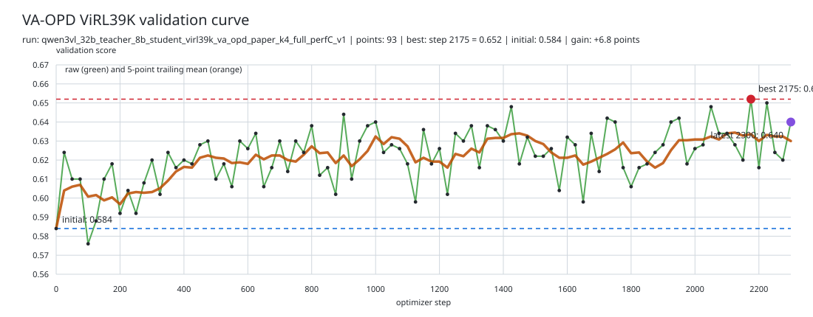

# VA-OPD ViRL39K validation curve update: 2026-10-11



Run lineage:

```text
qwen3vl_32b_teacher_8b_student_virl39k_va_opd_paper_k4_full_perfC_v1
```

The curve contains 93 validation points through step 2300. The baseline remains
0.584, the mean of all recorded points is 0.6219, and the historical best is
0.652 at step 2175.

Latest run state:

- The primary run last reached step 2324 before the checkpoint at step 2325
  failed because shared storage was full.
- The latest complete checkpoint is `global_step_2300`.
- The latest recorded validation is 0.640 at step 2300.
- The protected best is independently stored under
  `checkpoints/va_opd_native/protected_runs/qwen3vl_32b_teacher_8b_student_virl39k_va_opd_paper_k4_full_perfC_v1/global_step_2175`.
- Best-over-initial gain is +0.068 absolute score, or +6.8 percentage points
  (+11.64% relative to the initial 0.584).
